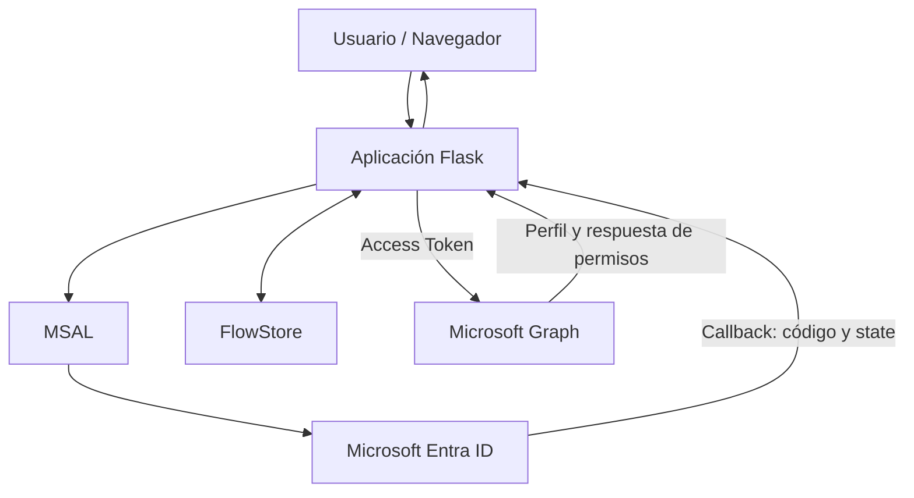

# Lab_09-OAuth-2.0-OpenID-Connect

## 1. Descripcionn del proyecto

Este laboratorio toma como referencia el capítulo 3 de la primera temporada de *La que se avecina*, **«Azulejos, un polígrafo y un paquete por correo»**.

En este episodio, Joaquín espera en el aeropuerto a una chica con la que ha iniciado una relación por Internet. Sin embargo, después de que Sergio y Eric le hagan creer que probablemente será poco atractiva, Joaquín decide marcharse y deja a su hermano Sergio esperándola. Cuando la chica aparece y resulta ser muy atractiva, Sergio no tarda en hacerse pasar por Joaquín para intentar conquistarla.

La situación plantea un problema bastante habitual en seguridad informática: **la suplantación de identidad**. Sergio consigue presentarse ante otra persona utilizando una identidad que no le pertenece, aprovechándose de que nadie comprueba realmente quién está al otro lado.

Trasladamos esta situación a **Mirador de Montepinar S.L.**, donde la comunidad necesita disponer de un portal interno al que sus usuarios puedan acceder de forma segura. Para evitar que cualquiera pueda hacerse pasar por otro vecino, la aplicación delegará la autenticación en Microsoft Entra ID mediante los protocolos OAuth 2.0 y OpenID Connect.

A lo largo del laboratorio construiremos una aplicación web con Python y Flask que permitirá iniciar sesión con una cuenta de Microsoft, consultar la identidad del usuario autenticado y acceder a determinados recursos de Microsoft Graph según los permisos concedidos.

Antonio Recio será nuestro usuario de pruebas. A través de su cuenta comprobaremos cómo Microsoft Entra ID gestiona la autenticación, cómo se obtiene y utiliza un token de acceso y qué ocurre cuando la aplicación intenta consultar información para la que no tiene permisos suficientes.

También trabajaremos distintos controles de seguridad de la aplicación, prestando atención a la protección de sesiones, CSRF, XSS, la gestión del estado del flujo de autenticación y el cierre de sesión.

Porque, a diferencia de Sergio, nuestra aplicación no puede fiarse de las apariencias: tiene que verificar correctamente la identidad antes de conceder acceso.

## 2. Objetivos del proyecto

El objetivo principal de este laboratorio es desarrollar una aplicación web que permita autenticar usuarios mediante Microsoft Entra ID, utilizando OAuth 2.0 y OpenID Connect, y aplicar controles de seguridad durante todo el proceso.

Para ello, se establecen los siguientes objetivos:

- **Implementar autenticación federada:** integrar Microsoft Entra ID en una aplicación Flask mediante el protocolo OpenID Connect y la biblioteca MSAL.
- **Comprender el flujo OAuth 2.0 Authorization Code:** trabajar con el intercambio de códigos de autorización y la obtención de tokens de acceso.
- **Validar la identidad del usuario:** interpretar los claims del ID token y consultar el perfil del usuario autenticado mediante Microsoft Graph.
- **Aplicar el principio de mínimo privilegio:** configurar permisos delegados y comprobar cómo Microsoft Graph limita el acceso a recursos no autorizados.
- **Proteger el flujo de autenticación:** implementar mecanismos de validación de estado, vinculación del navegador, control de caducidad y prevención de ataques de repetición (*replay*).
- **Endurecer la seguridad de la aplicación:** incorporar protección frente a XSS y CSRF, configurar adecuadamente las sesiones y validar los parámetros de configuración.
- **Implementar logging estructurado:** registrar los eventos relevantes de autenticación y mantener trazabilidad mediante identificadores de petición, evitando exponer información sensible.
- **Gestionar el cierre de sesión:** implementar el logout local y la redirección al endpoint de cierre de sesión de Microsoft Entra ID.
- **Validar la implementación:** desarrollar pruebas automatizadas para comprobar los controles de seguridad y verificar manualmente el funcionamiento de la integración.

El resultado será un portal web funcional que permitirá comprender cómo se integra un proveedor de identidad externo en una aplicación y qué medidas deben aplicarse para proteger el proceso de autenticación.

## 3. Arquitectura

El laboratorio utiliza una arquitectura cliente-servidor basada en Python y Flask. La aplicación delega la autenticación en Microsoft Entra ID mediante OAuth 2.0 y OpenID Connect, y utiliza Microsoft Graph para consultar los recursos autorizados del usuario.

### 3.1. Esquema general

El flujo de funcionamiento sigue esta secuencia:

1. El usuario accede al portal desde el navegador y solicita iniciar sesión.
2. Flask utiliza MSAL para iniciar el flujo de autenticación y redirige al usuario a Microsoft Entra ID.
3. Microsoft Entra ID autentica al usuario y devuelve la respuesta de autorización a la ruta `/getAToken`.
4. La aplicación valida el flujo recibido, comprueba el estado de la operación y recupera los tokens mediante MSAL.
5. Una vez autenticado, el usuario puede consultar su información a través de Microsoft Graph.
6. Cuando cierra sesión, la aplicación elimina la sesión local y redirige al endpoint de logout de Microsoft Entra ID.



La comunicación con Microsoft Entra ID permite verificar la identidad del usuario, mientras que Microsoft Graph proporciona acceso a los recursos para los que la aplicación dispone de permisos.

### 3.2. Componentes principales

| Componente | Responsabilidad |
|---|---|
| `run.py` | Punto de entrada para ejecutar la aplicación Flask. |
| `app/__init__.py` | Inicialización de Flask, registro de rutas, configuración de seguridad y contexto de las peticiones. |
| `app/routes.py` | Gestión de las rutas principales: inicio de sesión, callback, perfil, consultas y cierre de sesión. |
| `app/auth.py` | Integración con MSAL y gestión del flujo de autenticación. |
| `app/config.py` | Carga y validación de la configuración de la aplicación y de Microsoft Entra ID. |
| `app/flow_store.py` | Almacenamiento temporal de los flujos de autenticación, con caducidad y vinculación al navegador. |
| `app/graph.py` | Comunicación con Microsoft Graph y tratamiento de las respuestas de la API. |
| `app/logging_config.py` | Configuración del sistema de logging estructurado en formato JSON. |
| `app/templates/` | Plantillas Jinja2 utilizadas para representar la interfaz y las páginas de error. |
| `tests/` | Pruebas automatizadas de autenticación, sesiones, logging y controles de seguridad. |

### 3.3. Configuración de Microsoft Entra ID

La aplicación utiliza un registro de aplicación propio en Microsoft Entra ID, configurado para un único tenant (*Single Tenant*).

Se ha configurado:

- Un identificador de aplicación y un identificador de tenant.
- Un secreto de cliente almacenado mediante variables de entorno.
- Una URI de redirección para recibir el callback de autenticación.
- El permiso delegado `User.Read` para consultar el perfil del usuario autenticado mediante Microsoft Graph.

Se utiliza el flujo **Authorization Code con PKCE**, junto con los mecanismos `state` y `nonce` para reforzar la protección del proceso de autenticación.

### 3.4. Gestión de permisos y acceso a Microsoft Graph

La aplicación utiliza permisos delegados, actuando en nombre del usuario autenticado.

La consulta a `/me` permite recuperar el perfil de Antonio Recio con el permiso `User.Read`.

También se incluye una prueba de acceso al directorio mediante `/users`. Esta operación devuelve un error HTTP 403 porque la aplicación no dispone de los permisos necesarios para consultar el listado de usuarios.

Este comportamiento es intencionado y permite comprobar en la práctica el principio de mínimo privilegio: la aplicación solo debe disponer de los permisos que necesita para realizar sus funciones.

### 3.5. Controles de seguridad de la arquitectura

La aplicación incorpora controles en diferentes capas:

- **Autenticación:** OAuth 2.0, OpenID Connect, PKCE, `state` y `nonce`.
- **Gestión de flujos:** almacenamiento temporal en servidor, vinculación al navegador, caducidad y prevención de reutilización (*replay*).
- **Protección web:** plantillas Jinja2 con autoescape y protección CSRF mediante Flask-WTF.
- **Sesiones:** configuración de cookies de sesión, expiración y limpieza durante el cierre de sesión.
- **Configuración:** validación de parámetros y almacenamiento de secretos mediante variables de entorno.
- **Auditoría:** logging estructurado, identificadores de petición y exclusión de información sensible.

El almacenamiento de flujos se realiza actualmente en memoria mediante `FlowStore`, por lo que está orientado a este entorno de laboratorio. Una implementación de producción con múltiples procesos o instancias necesitaría un almacenamiento compartido con caducidad, como Redis.

## 4. Fases de implementación

El desarrollo del laboratorio se organizó en varias fases. Cada una fue incorporando funcionalidad y controles de seguridad, seguida de pruebas y revisiones para comprobar que los cambios no afectaban a los flujos que ya funcionaban.

### Fase 1. Registro y configuración de la aplicación en Microsoft Entra ID

El primer paso fue registrar la aplicación web de Mirador de Montepinar S.L. en el tenant de Microsoft Entra ID.

**Nombre del registro:** `Mirador de Montepinar - Portal de la comunidad`

Se configuró una aplicación de tipo Web, con autenticación de un único tenant y las siguientes direcciones:

| Configuración | URI |
|---|---|
| Redirect URI | `http://localhost:5000/getAToken` |
| Post-logout redirect URI | `http://localhost:5000/` |

También se creó un secreto de cliente para que Flask pudiera autenticarse como aplicación confidencial. El secreto se guarda en `.env` y no forma parte del repositorio.

El registro utiliza el permiso delegado `User.Read` de Microsoft Graph. Se decidió no conceder permisos adicionales de lectura del directorio, ya que el laboratorio debía demostrar el principio de mínimo privilegio.

**Evidencia:**


### Fase 2. Implementación del flujo OAuth 2.0 y OpenID Connect

Se desarrolló la integración entre Flask y Microsoft Entra ID mediante la biblioteca MSAL para Python.

La aplicación utiliza el flujo **Authorization Code Flow con PKCE**, apropiado para implementar un inicio de sesión seguro mediante un cliente web confidencial.

El proceso se desarrolló de la siguiente manera:

1. El usuario solicita iniciar sesión desde el portal.
2. MSAL prepara la solicitud de autorización y genera los parámetros necesarios para el flujo.
3. Se incorporan `state`, `nonce` y el material de PKCE, utilizando el método S256.
4. El navegador es redirigido al endpoint de autorización de Microsoft Entra ID.
5. Tras autenticarse, el usuario vuelve al callback `/getAToken` con el código de autorización y el estado.
6. Flask recupera el flujo original y comprueba que corresponde al intento de autenticación iniciado.
7. MSAL realiza el intercambio del código de autorización por los tokens correspondientes.
8. Se obtienen los claims de identidad del ID token y se establece la sesión del usuario.

El parámetro `state` permite vincular la respuesta con la solicitud original. El `nonce` protege la correlación de la identidad recibida con la autenticación iniciada. PKCE añade una comprobación mediante el `code_verifier`, que debe corresponder al desafío enviado inicialmente.

Se separó la lógica de autenticación de las rutas Flask, manteniendo la integración con MSAL en sus módulos correspondientes.

### Fase 3. Desarrollo del almacenamiento temporal FlowStore

Uno de los trabajos más importantes del laboratorio fue diseñar un mecanismo para gestionar los datos temporales de los intentos de autenticación sin introducirlos directamente en la cookie del navegador.

Para ello se desarrolló `FlowStore`, un almacenamiento temporal en memoria del servidor.

Cada flujo conserva la información necesaria para completar su correspondiente callback, incluyendo el estado, el verificador PKCE, el nonce y los datos de vinculación con el navegador.

Se implementaron los siguientes controles:

- **Caducidad:** tiempo de vida de 600 segundos por flujo.
- **Vinculación al navegador:** cada flujo incorpora un `binding_token` generado mediante `secrets.token_urlsafe(32)`.
- **Comparación segura:** se utiliza `secrets.compare_digest` para validar el token de vinculación.
- **Consumo atómico:** `pop_flow()` recupera y consume el flujo en una única operación protegida por `threading.Lock`.
- **Protección frente a reutilización:** un flujo consumido no puede volver a utilizarse.
- **Gestión de expiración:** los flujos caducados se rechazan y se eliminan del almacenamiento.
- **Concurrencia:** se permiten varios intentos independientes de autenticación desde distintas pestañas del mismo navegador.
- **Límite de almacenamiento:** se permiten hasta diez flujos por navegador. Cuando se supera el límite, se expulsan los más antiguos.

También se probaron situaciones de fallo, como callbacks iniciados desde otro navegador, estados incorrectos, intentos repetidos y flujos expirados.

Este componente evita depender únicamente de los parámetros que devuelve el navegador y mantiene los datos sensibles del proceso de autenticación bajo control del servidor.

### Fase 4. Endurecimiento de seguridad de la aplicación Flask

Una vez completada la autenticación, se realizó una revisión de seguridad del portal. Esta fase dio lugar a seis bloques de corrección y mejora, identificados como SEC-01 a SEC-06.

#### SEC-01. Protección frente a Cross-Site Scripting (XSS)

Se revisó el renderizado de contenido dinámico y se sustituyó la construcción de HTML mediante cadenas f-string por plantillas Jinja2.

La aplicación utiliza el autoescape de Jinja2 para escapar los valores procedentes del usuario y de los claims antes de mostrarlos en el navegador.

Se añadieron pruebas para comprobar que los datos manipulados no se interpretan como código HTML o JavaScript.

#### SEC-02. Protección CSRF

Se integró Flask-WTF para proteger los formularios mediante tokens CSRF.

Se prestó especial atención al cierre de sesión: el endpoint `/logout` requiere una petición POST protegida.

Una petición GET a esta ruta no debe ejecutar el cierre de sesión. También se probaron tanto las peticiones sin token válido como las que incluyen un token correcto.

#### SEC-03. Protección y gestión de sesiones

Se reforzó la configuración de las sesiones de Flask:

- Cookies `HttpOnly`.
- Política `SameSite=Lax`.
- Parámetro `Secure` configurable para entornos HTTPS.
- Firma criptográfica de las cookies.
- Expiración de sesión.
- Limpieza de la sesión anterior mediante `session.clear()` antes de establecer una nueva identidad.

Se comprobó que los datos temporales del flujo OAuth, como el `code_verifier` y el `nonce`, no se almacenan en la cookie del navegador.

Las cookies están firmadas, pero no cifradas. Por este motivo, la aplicación evita almacenar en ellas secretos y tokens de acceso.

#### SEC-04. Validación de configuración y gestión de secretos

Se centralizaron las variables de configuración y se incorporaron validaciones para reducir errores de configuración.

Se revisaron, entre otros, los siguientes elementos:

- Clave de sesión de Flask.
- Identificador del tenant.
- URI de retorno tras el logout.
- Tiempo de vida de los flujos temporales.
- Dominios y valores de configuración.
- Separación entre configuración de ejemplo y secretos reales.

El archivo `.env` permanece fuera del repositorio y `.env.example` sirve como referencia para preparar una instalación.

#### SEC-05. Logging estructurado y protección de información sensible

Se implementó un sistema de logging estructurado en formato JSON.

El formato controla los campos permitidos mediante una lista explícita y utiliza un identificador de petición generado en el servidor.

Se evitó registrar tokens de acceso, secretos de cliente y otros elementos sensibles del proceso de autenticación.

También se revisaron los datos adicionales que pueden llegar a los registros para impedir que información arbitraria termine exponiéndose.

#### SEC-06. Cierre de sesión OIDC

Se implementó el cierre de sesión federado teniendo en cuenta los dos niveles de la aplicación:

1. Limpieza de la sesión local de Flask.
2. Redirección al endpoint de logout del tenant de Microsoft Entra ID.

Se configuró `post_logout_redirect_uri` para que el usuario vuelva al portal después de completar el cierre de sesión.

Se comprobó que la URI de retorno está registrada como Redirect URI de tipo Web y se revisó que no se confundiera con la configuración independiente de Front-channel logout.

También se decidió no almacenar el ID token para utilizar `id_token_hint`. La aplicación mantiene una gestión de sesión más sencilla y evita introducir el token en la cookie o añadir almacenamiento persistente sin una necesidad funcional demostrada.

### Fase 5. Integración con Microsoft Graph y autorización

Una vez conseguida la autenticación, se incorporó Microsoft Graph para consultar información corporativa utilizando el access token delegado.

Se implementaron dos escenarios para demostrar la diferencia entre autenticación y autorización.

**Consulta del perfil personal: `GET /me`**

La aplicación utiliza el permiso delegado `User.Read` para consultar el perfil del usuario que ha iniciado sesión.

Los datos obtenidos se utilizan para mostrar información dinámica en el portal, como el nombre y el identificador de la cuenta.

**Consulta de otros usuarios: `GET /users`**

Se realizó una segunda consulta para comprobar qué ocurría al intentar acceder al directorio de usuarios con los permisos concedidos.

Microsoft Graph devuelve HTTP 403 Forbidden porque la aplicación no dispone de los permisos necesarios para realizar esa operación.

El resultado es deliberado. El usuario está autenticado, pero la aplicación no tiene autorización suficiente para consultar el directorio completo.

De esta forma se demuestra que disponer de una identidad válida no implica tener acceso a todos los recursos corporativos.

**Evidencias:**


### Fase 6. Identidad dinámica y validación con usuarios reales

Durante las primeras fases del laboratorio se utilizaron distintas cuentas de prueba para comprobar la integración con Entra ID.

Posteriormente se revisó la aplicación para eliminar cualquier dependencia de una identidad codificada manualmente y hacer que el portal representara dinámicamente al usuario autenticado.

La plantilla utiliza los datos de identidad y del perfil de Graph para mostrar el contenido correspondiente a cada sesión.

Se realizaron autenticaciones reales contra el tenant con dos usuarios:

- **Joaquín Arias:** `jarias@monte...`
- **Sergio Arias:** `sarias@monte...`

En ambos casos se comprobó que el inicio de sesión se completaba correctamente y que el portal mostraba la identidad correspondiente.

Se verificó también el cierre de sesión real contra Microsoft Entra ID.

**Evidencias:**


### Fase 7. Gestión de errores y validación de casos límite

Se revisó el comportamiento de la aplicación cuando el callback OAuth/OIDC no devuelve los datos esperados.

Se corrigieron las respuestas HTTP para representar mejor el origen de cada fallo:

| Situación | Código HTTP | Tratamiento |
|---|---:|---|
| Error OAuth durante el callback o intercambio del código | 400 Bad Request | Se muestra el error de autenticación y se consume el flujo. |
| MSAL no devuelve `access_token` | 502 Bad Gateway | Se trata como respuesta inesperada del proveedor de identidad. |
| No se reciben los claims de identidad | 502 Bad Gateway | Se rechaza la creación de la sesión autenticada. |
| Acceso no autorizado a `/users` | 403 Forbidden | Se informa de la falta de permisos sobre el recurso. |

Se añadieron pruebas específicas para los errores de ausencia de `access_token` y de claims OIDC.

También se actualizó la prueba que comprueba el tratamiento de errores OAuth para verificar el nuevo código HTTP 400.

En los escenarios de error se comprueba que el flujo temporal queda eliminado y que no se establece una sesión autenticada.

### Fase 8. Pruebas automatizadas, auditoría y correcciones finales

El laboratorio se sometió a varios ciclos de revisión y corrección. Se inspeccionaron las rutas, las plantillas, la gestión de sesiones, los flujos temporales, la integración con Graph y las pruebas automatizadas.

La suite se ejecuta mediante:

```powershell
python -m unittest discover tests -v
```

La validación final obtuvo el siguiente resultado:

```text
Ran 67 tests
OK
```

Se incorporaron pruebas para verificar el comportamiento ante errores de autenticación, la limpieza del FlowStore, la configuración de sesiones, la protección CSRF, el autoescape de Jinja2 y la representación dinámica de distintas identidades.

La revisión final también incluyó la fijación de las cinco dependencias directas en `requirements.txt`, utilizando las versiones verificadas en el entorno virtual del proyecto.

El resultado es una aplicación que ha pasado tanto por pruebas automatizadas como por comprobaciones manuales contra un tenant real de Microsoft Entra ID.

**Evidencia:**


---

## 5. Conclusiones y resultados de validación

El laboratorio ha permitido desarrollar y comprobar una aplicación web que delega la autenticación en Microsoft Entra ID mediante OAuth 2.0 y OpenID Connect.

El resultado no se limita a completar un inicio de sesión. Se ha trabajado en el ciclo completo de autenticación, desde la creación de la solicitud y el almacenamiento temporal del flujo hasta el procesamiento del callback, la creación de la sesión, las consultas a Microsoft Graph y el cierre de sesión federado.

### Resultados técnicos

| Área | Resultado |
|---|---|
| OAuth 2.0 | Authorization Code Flow implementado |
| OpenID Connect | Claims de identidad integrados |
| PKCE | Implementado con S256 |
| State y nonce | Gestión y validación integradas |
| FlowStore | Almacenamiento temporal con controles de concurrencia y reutilización |
| Sesiones Flask | Cookies configuradas y sesión renovada durante el login |
| CSRF | Protección de formularios y logout |
| XSS | Autoescape mediante Jinja2 |
| Logging | Registros JSON con campos controlados |
| Microsoft Graph | Consulta personal mediante `User.Read` |
| Mínimo privilegio | Acceso a `/users` rechazado con HTTP 403 |
| Logout | Cierre de sesión local y federado |
| Pruebas | 67 aprobadas, sin fallos |

### Validación con Microsoft Entra ID

Se realizaron pruebas manuales con dos identidades reales del tenant:

- Joaquín Arias inició sesión correctamente y el portal mostró sus datos.
- Sergio Arias inició sesión correctamente y el portal mostró su propia identidad.

Se confirmó que ambas cuentas utilizan la misma aplicación y que la información mostrada depende de la identidad autenticada.

También se validó el cierre de sesión real contra Microsoft Entra ID.

### Resultado de la suite automatizada

```text
Ran 67 tests
OK
```

Las pruebas incluyen escenarios de funcionamiento normal, errores OAuth/OIDC y controles de seguridad. Las autenticaciones reales con Joaquín y Sergio se registraron como validaciones manuales independientes de la suite automatizada.

El laboratorio queda validado para su propósito formativo en un entorno local. No se presenta como una aplicación lista para producción.

## 6. Tecnologías y competencias desarrolladas

| Tecnología | Aplicación en el laboratorio | Competencia desarrollada |
|---|---|---|
| Microsoft Entra ID | Registro de aplicación, tenant y configuración de autenticación | Administración de identidad cloud y autenticación federada |
| OAuth 2.0 | Authorization Code Flow | Implementación de flujos de autorización |
| OpenID Connect | ID token, claims y validación de identidad | Gestión de identidad y autenticación |
| PKCE | `code_verifier`, `code_challenge` y S256 | Protección del intercambio de códigos |
| MSAL Python | Cliente confidencial e intercambio de tokens | Integración con Microsoft Identity Platform |
| Microsoft Graph | API `/me` y `/users` | Consumo de API y permisos delegados |
| Python 3.13 | Lógica de aplicación, configuración y tests | Desarrollo y automatización |
| Flask | Rutas, sesiones y renderizado del portal | Desarrollo de aplicaciones web |
| Flask-WTF | Protección CSRF | Seguridad de formularios y peticiones |
| Jinja2 | Plantillas con autoescape | Mitigación de XSS |
| `secrets` | Generación y comparación segura de tokens | Manejo de valores aleatorios sensibles |
| `threading.Lock` | Control de concurrencia en FlowStore | Sincronización y gestión de estado |
| `unittest` | Pruebas automatizadas | Validación de lógica y regresiones |
| `unittest.mock` | Simulación de respuestas de MSAL y Graph | Pruebas controladas de integraciones |
| `python-dotenv` | Carga de configuración local | Separación de configuración y código |
| `requests` | Consultas HTTP a Microsoft Graph | Integración con servicios REST |
| GitHub | Organización y documentación del proyecto | Presentación de portfolio técnico |

### Competencias IAM practicadas

El laboratorio trabaja áreas directamente relacionadas con funciones de IAM Engineer e Identity Security:

- Integración de aplicaciones con un proveedor de identidad corporativo.
- Autenticación federada y protocolos OAuth 2.0 / OIDC.
- Gestión segura de credenciales y tokens.
- Autorización mediante permisos delegados.
- Aplicación del principio de mínimo privilegio.
- Diferenciación entre autenticación y autorización.
- Gestión de sesiones y cierre de sesión.
- Análisis de errores de identidad y acceso.
- Pruebas de seguridad y validación de controles.

## 7. Limitaciones, decisiones de arquitectura y próximas mejoras

El laboratorio está diseñado para aprender y validar conceptos de IAM en un entorno controlado. Durante su desarrollo se identificaron varias limitaciones que deberían abordarse antes de utilizar la aplicación en un entorno productivo.

### Limitaciones actuales

**Almacenamiento temporal en memoria**

FlowStore utiliza memoria local del proceso Flask. El diseño incorpora bloqueo de concurrencia, caducidad y control de reutilización, pero no permite compartir automáticamente los flujos entre distintos procesos o instancias de la aplicación.

En un despliegue distribuido sería necesario migrarlo a un almacenamiento compartido, como Redis, con expiración de claves.

**Sesiones firmadas, pero no cifradas**

Las cookies de sesión de Flask están protegidas mediante firma criptográfica, pero su contenido no está cifrado. La aplicación evita guardar en ellas tokens de acceso o datos sensibles del proceso PKCE.

Para un despliegue real habría que revisar también la gestión de claves, el almacenamiento de sesiones y los requisitos operativos del entorno.

**Sin persistencia de tokens**

El access token obtenido se utiliza para consultar Microsoft Graph, pero no se conserva como parte de la sesión web ni se ha implementado una caché persistente para renovar tokens silenciosamente.

Si se incorporase acceso prolongado a recursos protegidos, habría que diseñar una estrategia específica de caché y protección de tokens.

**Logout sin `id_token_hint`**

Se decidió no almacenar el ID token únicamente para enviarlo durante el cierre de sesión. La aplicación limpia la sesión local y redirige al endpoint de logout del tenant.

Esta decisión evita añadir almacenamiento y complejidad que no son necesarios para demostrar el flujo implementado.

**Entorno local de desarrollo**

Las direcciones `localhost` y la configuración actual están destinadas a pruebas locales. Un despliegue productivo necesitaría HTTPS, una gestión adecuada de secretos, configuración específica del entorno y una revisión completa de seguridad.

### Próximas mejoras

- Migrar FlowStore a Redis para soportar múltiples procesos e instancias.
- Implementar una estrategia de caché segura de tokens y renovación silenciosa cuando el caso de uso lo requiera.
- Añadir pruebas de integración controladas contra Microsoft Graph, además de las pruebas con dependencias simuladas.
- Preparar un entorno de despliegue con HTTPS y un sistema externo de gestión de secretos.
- Incorporar monitorización de eventos de autenticación y autorización.
- Estudiar la integración de Front-channel Logout para escenarios de Single Sign-On con varias aplicaciones.

**Estado del proyecto:** laboratorio funcional y validado mediante 67 pruebas automatizadas y autenticaciones reales en Microsoft Entra ID. Las mejoras pendientes corresponden a su evolución hacia un entorno distribuido y de producción.
