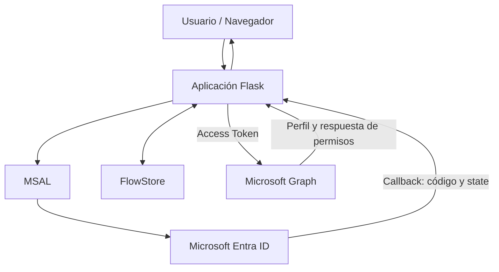

# Lab_09-OAuth-2.0-OpenID-Connect

## 1. Descripcionn del proyecto

Este laboratorio toma como referencia el capítulo 3 de la primera temporada de *La que se avecina*, **«Azulejos, un polígrafo y un paquete por correo»**.

En este episodio, Joaquín espera en el aeropuerto a una chica con la que ha iniciado una relación por Internet. Sin embargo, después de que Sergio y Eric le hagan creer que probablemente será poco atractiva, Joaquín decide marcharse y deja a su hermano Sergio esperándola. Cuando la chica aparece y resulta ser muy atractiva, Sergio no tarda en hacerse pasar por Joaquín para intentar conquistarla.

La situación plantea un problema bastante habitual en seguridad informática: **la suplantación de identidad**. Sergio consigue presentarse ante otra persona utilizando una identidad que no le pertenece, aprovechándose de que nadie comprueba realmente quién está al otro lado.

Trasladamos esta situación a **Mirador de Montepinar S.L.**, donde la comunidad necesita disponer de un portal interno al que sus usuarios puedan acceder de forma segura. Para evitar que cualquiera pueda hacerse pasar por otro vecino, la aplicación delegará la autenticación en Microsoft Entra ID mediante los protocolos OAuth 2.0 y OpenID Connect.

A lo largo del laboratorio construiremos una aplicación web con Python y Flask que permitirá iniciar sesión con una cuenta de Microsoft, consultar la identidad del usuario autenticado y acceder a determinados recursos de Microsoft Graph según los permisos concedidos.

Antonio Recio será nuestro usuario de pruebas. A través de su cuenta comprobaremos cómo Microsoft Entra ID gestiona la autenticación, cómo se obtiene y utiliza un token de acceso y qué ocurre cuando la aplicación intenta consultar información para la que no tiene permisos suficientes.

También trabajaremos distintos controles de seguridad de la aplicación, prestando atención a la protección de sesiones, CSRF, XSS, la gestión del estado del flujo de autenticación y el cierre de sesión.

Porque, a diferencia de Sergio, nuestra aplicación no puede fiarse de las apariencias: tiene que verificar correctamente la identidad antes de conceder acceso.

## 2. Objetivos del proyecto

El objetivo principal de este laboratorio es desarrollar una aplicación web que permita autenticar usuarios mediante Microsoft Entra ID, utilizando OAuth 2.0 y OpenID Connect, y aplicar controles de seguridad durante todo el proceso.

Para ello, se establecen los siguientes objetivos:

- **Implementar autenticación federada:** integrar Microsoft Entra ID en una aplicación Flask mediante el protocolo OpenID Connect y la biblioteca MSAL.
- **Comprender el flujo OAuth 2.0 Authorization Code:** trabajar con el intercambio de códigos de autorización y la obtención de tokens de acceso.
- **Validar la identidad del usuario:** interpretar los claims del ID token y consultar el perfil del usuario autenticado mediante Microsoft Graph.
- **Aplicar el principio de mínimo privilegio:** configurar permisos delegados y comprobar cómo Microsoft Graph limita el acceso a recursos no autorizados.
- **Proteger el flujo de autenticación:** implementar mecanismos de validación de estado, vinculación del navegador, control de caducidad y prevención de ataques de repetición (*replay*).
- **Endurecer la seguridad de la aplicación:** incorporar protección frente a XSS y CSRF, configurar adecuadamente las sesiones y validar los parámetros de configuración.
- **Implementar logging estructurado:** registrar los eventos relevantes de autenticación y mantener trazabilidad mediante identificadores de petición, evitando exponer información sensible.
- **Gestionar el cierre de sesión:** implementar el logout local y la redirección al endpoint de cierre de sesión de Microsoft Entra ID.
- **Validar la implementación:** desarrollar pruebas automatizadas para comprobar los controles de seguridad y verificar manualmente el funcionamiento de la integración.

El resultado será un portal web funcional que permitirá comprender cómo se integra un proveedor de identidad externo en una aplicación y qué medidas deben aplicarse para proteger el proceso de autenticación.

## 3. Arquitectura

El laboratorio utiliza una arquitectura cliente-servidor basada en Python y Flask. La aplicación delega la autenticación en Microsoft Entra ID mediante OAuth 2.0 y OpenID Connect, y utiliza Microsoft Graph para consultar los recursos autorizados del usuario.

### 3.1. Esquema general

El flujo de funcionamiento sigue esta secuencia:

1. El usuario accede al portal desde el navegador y solicita iniciar sesión.
2. Flask utiliza MSAL para iniciar el flujo de autenticación y redirige al usuario a Microsoft Entra ID.
3. Microsoft Entra ID autentica al usuario y devuelve la respuesta de autorización a la ruta `/getAToken`.
4. La aplicación valida el flujo recibido, comprueba el estado de la operación y recupera los tokens mediante MSAL.
5. Una vez autenticado, el usuario puede consultar su información a través de Microsoft Graph.
6. Cuando cierra sesión, la aplicación elimina la sesión local y redirige al endpoint de logout de Microsoft Entra ID.

La comunicación con Microsoft Entra ID permite verificar la identidad del usuario, mientras que Microsoft Graph proporciona acceso a los recursos para los que la aplicación dispone de permisos.

### 3.2. Componentes principales

| Componente | Responsabilidad |
|---|---|
| `run.py` | Punto de entrada para ejecutar la aplicación Flask. |
| `app/__init__.py` | Inicialización de Flask, registro de rutas, configuración de seguridad y contexto de las peticiones. |
| `app/routes.py` | Gestión de las rutas principales: inicio de sesión, callback, perfil, consultas y cierre de sesión. |
| `app/auth.py` | Integración con MSAL y gestión del flujo de autenticación. |
| `app/config.py` | Carga y validación de la configuración de la aplicación y de Microsoft Entra ID. |
| `app/flow_store.py` | Almacenamiento temporal de los flujos de autenticación, con caducidad y vinculación al navegador. |
| `app/graph.py` | Comunicación con Microsoft Graph y tratamiento de las respuestas de la API. |
| `app/logging_config.py` | Configuración del sistema de logging estructurado en formato JSON. |
| `app/templates/` | Plantillas Jinja2 utilizadas para representar la interfaz y las páginas de error. |
| `tests/` | Pruebas automatizadas de autenticación, sesiones, logging y controles de seguridad. |

### 3.3. Configuración de Microsoft Entra ID

La aplicación utiliza un registro de aplicación propio en Microsoft Entra ID, configurado para un único tenant (*Single Tenant*).

Se ha configurado:

- Un identificador de aplicación y un identificador de tenant.
- Un secreto de cliente almacenado mediante variables de entorno.
- Una URI de redirección para recibir el callback de autenticación.
- El permiso delegado `User.Read` para consultar el perfil del usuario autenticado mediante Microsoft Graph.

Se utiliza el flujo **Authorization Code con PKCE**, junto con los mecanismos `state` y `nonce` para reforzar la protección del proceso de autenticación.

### 3.4. Gestión de permisos y acceso a Microsoft Graph

La aplicación utiliza permisos delegados, actuando en nombre del usuario autenticado.

La consulta a `/me` permite recuperar el perfil de Antonio Recio con el permiso `User.Read`.

También se incluye una prueba de acceso al directorio mediante `/users`. Esta operación devuelve un error HTTP 403 porque la aplicación no dispone de los permisos necesarios para consultar el listado de usuarios.

Este comportamiento es intencionado y permite comprobar en la práctica el principio de mínimo privilegio: la aplicación solo debe disponer de los permisos que necesita para realizar sus funciones.

### 3.5. Controles de seguridad de la arquitectura

La aplicación incorpora controles en diferentes capas:

- **Autenticación:** OAuth 2.0, OpenID Connect, PKCE, `state` y `nonce`.
- **Gestión de flujos:** almacenamiento temporal en servidor, vinculación al navegador, caducidad y prevención de reutilización (*replay*).
- **Protección web:** plantillas Jinja2 con autoescape y protección CSRF mediante Flask-WTF.
- **Sesiones:** configuración de cookies de sesión, expiración y limpieza durante el cierre de sesión.
- **Configuración:** validación de parámetros y almacenamiento de secretos mediante variables de entorno.
- **Auditoría:** logging estructurado, identificadores de petición y exclusión de información sensible.

El almacenamiento de flujos se realiza actualmente en memoria mediante `FlowStore`, por lo que está orientado a este entorno de laboratorio. Una implementación de producción con múltiples procesos o instancias necesitaría un almacenamiento compartido con caducidad, como Redis.

## 4. Fases de implmentación 

## 4. Fases de implementación

El desarrollo del laboratorio se ha dividido en diferentes fases, desde la configuración inicial de Microsoft Entra ID hasta la implementación de los controles de seguridad y la validación final de la aplicación.

Las capturas de pantalla se incorporan dentro de cada fase para mostrar las configuraciones realizadas y las evidencias obtenidas durante las pruebas.

### 4.1. Registro de la aplicación en Microsoft Entra ID

El primer paso fue registrar una nueva aplicación en Microsoft Entra ID con el nombre **Mirador de Montepinar - Portal de la comunidad**.

Se configuró como una aplicación de un único tenant (*Single Tenant*) y se estableció una URI de redirección de tipo Web:

`http://localhost:5000/getAToken`

También se habilitó el permiso delegado `User.Read` de Microsoft Graph, necesario para consultar el perfil del usuario autenticado.

Por último, se generó un secreto de cliente para permitir que la aplicación Flask se comunicara con Microsoft Entra ID. Este secreto se almacenó en variables de entorno y se excluyó del control de versiones.

**Evidencias:**

*Figura 1. Registro de la aplicación Mirador de Montepinar - Portal de la comunidad.*

*Figura 2. Configuración de la plataforma Web y URI de redirección.*

*Figura 3. Permiso delegado User.Read asignado a la aplicación.*

### 4.2. Preparación del entorno y estructura del proyecto

Se preparó el entorno de desarrollo con Python 3.13 y un entorno virtual de Python para aislar las dependencias.

Se instalaron las bibliotecas necesarias para desarrollar la aplicación:

- Flask, como framework web.
- MSAL, para la integración con Microsoft Entra ID.
- python-dotenv, para gestionar las variables de entorno.
- Requests, para las comunicaciones HTTP.
- Flask-WTF, para implementar protección CSRF.

Se organizó el proyecto en módulos independientes para separar la configuración, autenticación, rutas, comunicación con Microsoft Graph, almacenamiento de flujos y logging.

También se creó un archivo `.env.example` con las variables necesarias para configurar el proyecto sin exponer credenciales reales.

### 4.3. Implementación del flujo OAuth 2.0 y OpenID Connect

Se desarrolló el proceso de autenticación mediante el flujo Authorization Code, utilizando MSAL como biblioteca de integración.

El funcionamiento se divide en dos momentos:

**Inicio de sesión**

- El usuario solicita iniciar sesión desde el portal.
- Flask genera los parámetros necesarios para iniciar el flujo.
- MSAL prepara la solicitud de autorización.
- El navegador es redirigido al endpoint de Microsoft Entra ID.

**Callback de autenticación**

- Microsoft Entra ID devuelve la respuesta a `/getAToken`.
- La aplicación recupera el flujo de autenticación correspondiente.
- Se valida el estado de la operación.
- MSAL intercambia el código de autorización por los tokens correspondientes.
- Se obtiene la información de identidad y se establece la sesión autenticada.

Se trabajó con `state`, `nonce` y PKCE para reforzar la protección del flujo y evitar ataques de manipulación, repetición y apropiación de respuestas de autenticación.

**Evidencias:**

*Figura 4. Pantalla de acceso al portal de Mirador de Montepinar S.L.*

*Figura 5. Proceso de autenticación del usuario mediante Microsoft Entra ID.*

### 4.4. Gestión segura de los flujos de autenticación

Durante el desarrollo se implementó `FlowStore`, un componente encargado de almacenar temporalmente los datos sensibles asociados a cada flujo de autenticación.

Esta solución evita depender exclusivamente de la cookie de sesión del navegador para conservar los datos internos del proceso.

Se incorporaron los siguientes mecanismos:

- Almacenamiento temporal en memoria del servidor.
- Tiempo de vida limitado mediante TTL.
- Vinculación de los flujos al navegador de origen.
- Validación del `state` y del token de vinculación.
- Consumo del flujo una sola vez para evitar ataques de repetición (*replay*).
- Compatibilidad con varios procesos de autenticación simultáneos, por ejemplo, al iniciar sesión desde diferentes pestañas.
- Eliminación de flujos caducados y gestión del límite máximo de operaciones almacenadas.

También se incorporó sincronización mediante `threading.Lock` para proteger el acceso concurrente al almacenamiento.

### 4.5. Integración con Microsoft Graph y principio de mínimo privilegio

Una vez implementada la autenticación, se desarrolló la comunicación con Microsoft Graph para consultar información del usuario autenticado.

Se realizaron dos pruebas principales:

**Consulta del perfil mediante `/me`**

Se utiliza el permiso delegado `User.Read` para recuperar información del usuario que ha iniciado sesión.

La aplicación muestra los datos disponibles del perfil y permite comprobar que la identidad autenticada se corresponde con la cuenta utilizada.

**Prueba de acceso al directorio mediante `/users`**

Se realizó una segunda consulta para intentar recuperar el listado de usuarios del directorio.

La petición devuelve un error HTTP 403 porque la aplicación no dispone de los permisos necesarios para acceder a ese recurso.

Este resultado es intencionado. Permite demostrar cómo Microsoft Graph aplica los permisos concedidos y por qué no se deben solicitar privilegios adicionales cuando no son necesarios.

**Evidencias:**

*Figura 6. Perfil de Antonio Recio y estado de sesión autenticada.*

*Figura 7. Información de identidad y claims obtenidos durante la autenticación.*

*Figura 8. Consulta del perfil mediante `/me` y denegación de acceso al directorio mediante `/users` (HTTP 403).*

### 4.6. Implementación de controles de seguridad

Una vez completada la funcionalidad principal, se realizó un proceso de revisión y endurecimiento de la aplicación.

Se identificaron y corrigieron diferentes aspectos de seguridad, organizados en seis bloques:

**SEC-01. Protección frente a XSS**

Se sustituyó la generación de HTML mediante cadenas dinámicas por plantillas Jinja2.

Se aprovechó el autoescape para evitar que los datos procedentes del usuario o de los claims se interpreten directamente como código HTML o JavaScript.

**SEC-02. Protección CSRF**

Se integró Flask-WTF para proteger las operaciones sensibles frente a solicitudes falsificadas.

El cierre de sesión se implementó mediante una petición POST protegida con token CSRF, evitando que pueda ejecutarse mediante una simple petición GET.

**SEC-03. Endurecimiento de sesiones**

Se revisó la configuración de las cookies de sesión y se incorporaron medidas como:

- `HttpOnly`, para impedir el acceso a la cookie desde JavaScript.
- `SameSite=Lax`, para reducir determinados riesgos de solicitudes entre sitios.
- Configuración de `Secure` según el entorno.
- Tiempo de vida limitado de las sesiones.
- Limpieza de los datos de sesión durante los procesos de autenticación y cierre de sesión.

**SEC-04. Validación de configuración**

Se reforzó la validación de los parámetros utilizados por la aplicación, especialmente el identificador del tenant y la URI de redirección posterior al logout.

Se incorporaron comprobaciones para rechazar valores malformados, dominios inválidos, endpoints genéricos y direcciones HTTP externas no permitidas.

También se revisó la gestión de claves y tiempos de expiración para evitar configuraciones inseguras.

**SEC-05. Logging estructurado**

Se desarrolló un sistema de logging en formato JSON para facilitar la trazabilidad de los eventos de la aplicación.

Se incorporaron identificadores de petición (`request_id`) generados por el servidor, permitiendo relacionar los eventos de una misma solicitud.

El formato de salida utiliza una lista cerrada de campos para evitar que se incorporen atributos arbitrarios. También se revisaron los eventos de autenticación para evitar registrar tokens, secretos y otros datos sensibles.

**SEC-06. Endurecimiento del logout OIDC**

Se implementó el cierre de sesión mediante el endpoint específico del tenant de Microsoft Entra ID.

El proceso realiza dos operaciones:

1. Limpia la sesión local de Flask mediante `session.clear()`.
2. Redirige al usuario al endpoint de logout de Microsoft Entra ID, incluyendo la URI de retorno configurada.

También se validó la URI de cierre de sesión, se codificaron correctamente sus parámetros y se mantuvo la protección CSRF mediante POST.

**Evidencias:**

*Figura 9. Cierre de sesión y redirección a Microsoft Entra ID.*

### 4.7. Desarrollo de pruebas automatizadas

Para comprobar que las medidas implementadas funcionaban correctamente, se desarrolló una batería de pruebas automatizadas utilizando `unittest`.

Las pruebas cubren diferentes aspectos del laboratorio:

- Funcionamiento del flujo de autenticación.
- Gestión de estados, caducidad y reutilización de flujos.
- Vinculación de los procesos al navegador.
- Protección de sesiones y cookies.
- Prevención de XSS y CSRF.
- Validación de parámetros de configuración.
- Comportamiento del logging estructurado.
- Gestión del cierre de sesión OIDC.
- Tratamiento de errores y respuestas de Microsoft Graph.

Se utilizaron mocks para simular las respuestas de los servicios externos y poder comprobar el comportamiento de la aplicación sin depender de una conexión real durante cada ejecución de los tests.

La validación final de esta fase obtuvo el siguiente resultado:

**64 pruebas automatizadas superadas, sin errores ni fallos.**

**Evidencia:**

*Figura 10. Ejecución de la suite completa de pruebas automatizadas: 64 tests superados.*

### 4.8. Validación funcional con Microsoft Entra ID

Finalmente, se realizaron pruebas manuales con una cuenta real del entorno de Microsoft Entra ID.

Se utilizó **Antonio Recio** como usuario de pruebas para comprobar el ciclo completo de autenticación:

- Inicio de sesión desde la aplicación Flask.
- Redirección y autenticación mediante Microsoft Entra ID.
- Recuperación de la identidad del usuario.
- Consulta del perfil mediante Microsoft Graph.
- Comprobación de la denegación de acceso al directorio mediante `/users`.
- Cierre de sesión local y redirección al endpoint de logout de Microsoft Entra ID.

Todas las operaciones principales se completaron correctamente.

Con esta última comprobación se verificó que la aplicación no solo superaba las pruebas automatizadas, sino que también funcionaba correctamente integrada con los servicios reales de Microsoft.

## 5. Conclusiones

## 6. Tecnologías empleadas

## 7. Próximas mejoras 

