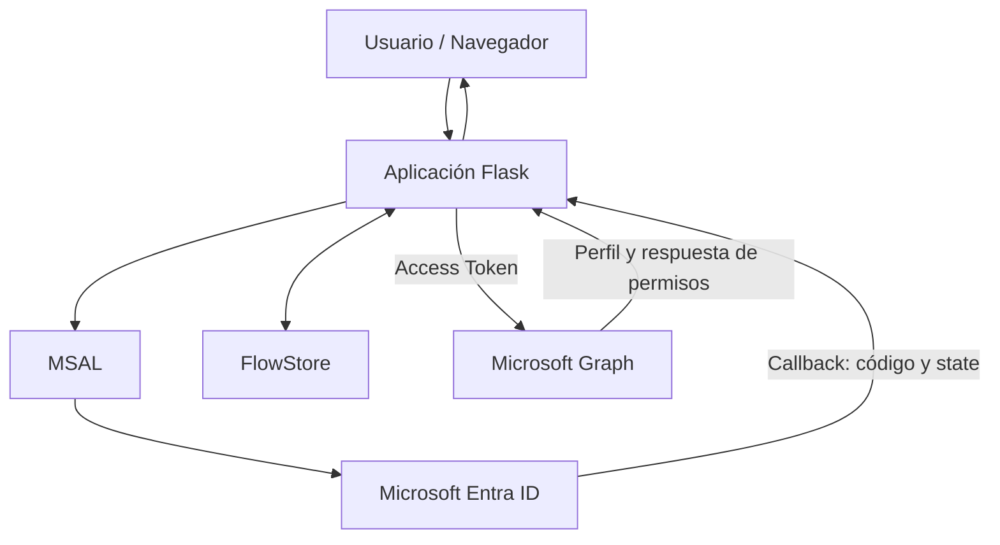

# Lab_09-OAuth-2.0-OpenID-Connect

## 1. Descripcionn del proyecto

Este laboratorio toma como referencia el capítulo 3 de la primera temporada de *La que se avecina*, **«Azulejos, un polígrafo y un paquete por correo»**.

En este episodio, Joaquín espera en el aeropuerto a una chica con la que ha iniciado una relación por Internet. Sin embargo, después de que Sergio y Eric le hagan creer que probablemente será poco atractiva, Joaquín decide marcharse y deja a su hermano Sergio esperándola. Cuando la chica aparece y resulta ser muy atractiva, Sergio no tarda en hacerse pasar por Joaquín para intentar conquistarla.

La situación plantea un problema bastante habitual en seguridad informática: **la suplantación de identidad**. Sergio consigue presentarse ante otra persona utilizando una identidad que no le pertenece, aprovechándose de que nadie comprueba realmente quién está al otro lado.

Trasladamos esta situación a **Mirador de Montepinar S.L.**, donde la comunidad necesita disponer de un portal interno al que sus usuarios puedan acceder de forma segura. Para evitar que cualquiera pueda hacerse pasar por otro vecino, la aplicación delegará la autenticación en Microsoft Entra ID mediante los protocolos OAuth 2.0 y OpenID Connect.

A lo largo del laboratorio construiremos una aplicación web con Python y Flask que permitirá iniciar sesión con una cuenta de Microsoft, consultar la identidad del usuario autenticado y acceder a determinados recursos de Microsoft Graph según los permisos concedidos.

Antonio Recio será nuestro usuario de pruebas. A través de su cuenta comprobaremos cómo Microsoft Entra ID gestiona la autenticación, cómo se obtiene y utiliza un token de acceso y qué ocurre cuando la aplicación intenta consultar información para la que no tiene permisos suficientes.

También trabajaremos distintos controles de seguridad de la aplicación, prestando atención a la protección de sesiones, CSRF, XSS, la gestión del estado del flujo de autenticación y el cierre de sesión.

Porque, a diferencia de Sergio, nuestra aplicación no puede fiarse de las apariencias: tiene que verificar correctamente la identidad antes de conceder acceso.

## 2. Objetivos del proyecto

El objetivo principal de este laboratorio es desarrollar una aplicación web que permita autenticar usuarios mediante Microsoft Entra ID, utilizando OAuth 2.0 y OpenID Connect, y aplicar controles de seguridad durante todo el proceso.

Para ello, se establecen los siguientes objetivos:

- **Implementar autenticación federada:** integrar Microsoft Entra ID en una aplicación Flask mediante el protocolo OpenID Connect y la biblioteca MSAL.
- **Comprender el flujo OAuth 2.0 Authorization Code:** trabajar con el intercambio de códigos de autorización y la obtención de tokens de acceso.
- **Validar la identidad del usuario:** interpretar los claims del ID token y consultar el perfil del usuario autenticado mediante Microsoft Graph.
- **Aplicar el principio de mínimo privilegio:** configurar permisos delegados y comprobar cómo Microsoft Graph limita el acceso a recursos no autorizados.
- **Proteger el flujo de autenticación:** implementar mecanismos de validación de estado, vinculación del navegador, control de caducidad y prevención de ataques de repetición (*replay*).
- **Endurecer la seguridad de la aplicación:** incorporar protección frente a XSS y CSRF, configurar adecuadamente las sesiones y validar los parámetros de configuración.
- **Implementar logging estructurado:** registrar los eventos relevantes de autenticación y mantener trazabilidad mediante identificadores de petición, evitando exponer información sensible.
- **Gestionar el cierre de sesión:** implementar el logout local y la redirección al endpoint de cierre de sesión de Microsoft Entra ID.
- **Validar la implementación:** desarrollar pruebas automatizadas para comprobar los controles de seguridad y verificar manualmente el funcionamiento de la integración.

El resultado será un portal web funcional que permitirá comprender cómo se integra un proveedor de identidad externo en una aplicación y qué medidas deben aplicarse para proteger el proceso de autenticación.

## 3. Arquitectura

El laboratorio utiliza una arquitectura cliente-servidor basada en Python y Flask. La aplicación delega la autenticación en Microsoft Entra ID mediante OAuth 2.0 y OpenID Connect, y utiliza Microsoft Graph para consultar los recursos autorizados del usuario.

### 3.1. Esquema general

El flujo de funcionamiento sigue esta secuencia:

1. El usuario accede al portal desde el navegador y solicita iniciar sesión.
2. Flask utiliza MSAL para iniciar el flujo de autenticación y redirige al usuario a Microsoft Entra ID.
3. Microsoft Entra ID autentica al usuario y devuelve la respuesta de autorización a la ruta `/getAToken`.
4. La aplicación valida el flujo recibido, comprueba el estado de la operación y recupera los tokens mediante MSAL.
5. Una vez autenticado, el usuario puede consultar su información a través de Microsoft Graph.
6. Cuando cierra sesión, la aplicación elimina la sesión local y redirige al endpoint de logout de Microsoft Entra ID.

La comunicación con Microsoft Entra ID permite verificar la identidad del usuario, mientras que Microsoft Graph proporciona acceso a los recursos para los que la aplicación dispone de permisos.

### 3.2. Componentes principales

| Componente | Responsabilidad |
|---|---|
| `run.py` | Punto de entrada para ejecutar la aplicación Flask. |
| `app/__init__.py` | Inicialización de Flask, registro de rutas, configuración de seguridad y contexto de las peticiones. |
| `app/routes.py` | Gestión de las rutas principales: inicio de sesión, callback, perfil, consultas y cierre de sesión. |
| `app/auth.py` | Integración con MSAL y gestión del flujo de autenticación. |
| `app/config.py` | Carga y validación de la configuración de la aplicación y de Microsoft Entra ID. |
| `app/flow_store.py` | Almacenamiento temporal de los flujos de autenticación, con caducidad y vinculación al navegador. |
| `app/graph.py` | Comunicación con Microsoft Graph y tratamiento de las respuestas de la API. |
| `app/logging_config.py` | Configuración del sistema de logging estructurado en formato JSON. |
| `app/templates/` | Plantillas Jinja2 utilizadas para representar la interfaz y las páginas de error. |
| `tests/` | Pruebas automatizadas de autenticación, sesiones, logging y controles de seguridad. |

### 3.3. Configuración de Microsoft Entra ID

La aplicación utiliza un registro de aplicación propio en Microsoft Entra ID, configurado para un único tenant (*Single Tenant*).

Se ha configurado:

- Un identificador de aplicación y un identificador de tenant.
- Un secreto de cliente almacenado mediante variables de entorno.
- Una URI de redirección para recibir el callback de autenticación.
- El permiso delegado `User.Read` para consultar el perfil del usuario autenticado mediante Microsoft Graph.

Se utiliza el flujo **Authorization Code con PKCE**, junto con los mecanismos `state` y `nonce` para reforzar la protección del proceso de autenticación.

### 3.4. Gestión de permisos y acceso a Microsoft Graph

La aplicación utiliza permisos delegados, actuando en nombre del usuario autenticado.

La consulta a `/me` permite recuperar el perfil de Antonio Recio con el permiso `User.Read`.

También se incluye una prueba de acceso al directorio mediante `/users`. Esta operación devuelve un error HTTP 403 porque la aplicación no dispone de los permisos necesarios para consultar el listado de usuarios.

Este comportamiento es intencionado y permite comprobar en la práctica el principio de mínimo privilegio: la aplicación solo debe disponer de los permisos que necesita para realizar sus funciones.

### 3.5. Controles de seguridad de la arquitectura

La aplicación incorpora controles en diferentes capas:

- **Autenticación:** OAuth 2.0, OpenID Connect, PKCE, `state` y `nonce`.
- **Gestión de flujos:** almacenamiento temporal en servidor, vinculación al navegador, caducidad y prevención de reutilización (*replay*).
- **Protección web:** plantillas Jinja2 con autoescape y protección CSRF mediante Flask-WTF.
- **Sesiones:** configuración de cookies de sesión, expiración y limpieza durante el cierre de sesión.
- **Configuración:** validación de parámetros y almacenamiento de secretos mediante variables de entorno.
- **Auditoría:** logging estructurado, identificadores de petición y exclusión de información sensible.

El almacenamiento de flujos se realiza actualmente en memoria mediante `FlowStore`, por lo que está orientado a este entorno de laboratorio. Una implementación de producción con múltiples procesos o instancias necesitaría un almacenamiento compartido con caducidad, como Redis.

## 4. Fases de implementación

### Fase 1. Registro de aplicación en Microsoft Entra ID

Se registró la aplicación web en el tenant de Mirador de Montepinar S.L.

Se configuraron las URI de redirección y cierre de sesión, así como el permiso delegado User.Read de Microsoft Graph.

Se creó un secreto de cliente para que la aplicación Flask pudiera autenticarse como cliente confidencial. El secreto se mantiene en el archivo local .env, excluido del repositorio.

### Fase 2. Implementación de OAuth 2.0 y OpenID Connect

Se integró MSAL Python para implementar el flujo Authorization Code.

La aplicación utiliza OpenID Connect para obtener información de identidad y PKCE para proteger el intercambio del código de autorización.

Se incorporaron los parámetros state y nonce para vincular la solicitud y validar la respuesta recibida.

### Fase 3. Almacenamiento y protección del flujo de autenticación

Se desarrolló un almacén temporal en servidor (FlowStore) para gestionar los datos asociados a cada intento de inicio de sesión.

Se añadieron controles para evitar la reutilización de códigos de autorización, el consumo de flujos por navegadores distintos y la aceptación de solicitudes expiradas.

El almacén utiliza un bloqueo de concurrencia y una vinculación específica con el navegador que inició la autenticación.

### Fase 4. Gestión de sesiones y controles de seguridad

Se reforzó la gestión de sesiones de Flask mediante:

Cookies HttpOnly.

Configuración SameSite=Lax.

Opción Secure configurable para entornos HTTPS.

Firma criptográfica de las cookies de sesión.

Expiración de sesión.

Limpieza de la sesión anterior antes de establecer una nueva identidad.

También se incorporaron las siguientes medidas:

Protección CSRF: Flask-WTF protege los formularios y el endpoint de logout, que requiere una petición POST.

Protección XSS: se sustituyó el renderizado HTML mediante cadenas f-string por plantillas Jinja2 con autoescape.

Gestión de configuración: se centralizaron los parámetros de configuración, se incorporaron validaciones y se separaron los secretos del código fuente.

Logging estructurado: se implementó un formato JSON con una lista controlada de campos, evitando registrar tokens, secretos y otros datos sensibles.

### Fase 5. Integración con Microsoft Graph

Una vez autenticado el usuario, la aplicación utiliza el access token para consultar Microsoft Graph.

Se implementaron dos escenarios:

Consulta del perfil (/me)

La llamada permite recuperar información del usuario autenticado mediante el permiso delegado User.Read.

El portal presenta datos dinámicos, como el nombre y el identificador de la cuenta, en función de la identidad que ha iniciado sesión.

Consulta del directorio (/users)

Se realiza una prueba de acceso a información de otros usuarios del directorio.

La operación devuelve HTTP 403 Forbidden debido a que la aplicación no dispone de los permisos necesarios.

Este resultado es intencionado y permite demostrar el principio de mínimo privilegio: una autenticación correcta no implica que el usuario o la aplicación tengan autorización para acceder a todos los recursos.

### Fase 6. Gestión de errores y cierre de sesión

Se implementó el cierre de sesión federado para limpiar la sesión local de Flask y redirigir al endpoint de logout de Microsoft Entra ID.

Se corrigió también la clasificación HTTP de los errores del callback:

Situación

Respuesta

Error OAuth durante el callback o intercambio del código

400 Bad Request

Respuesta sin access token

502 Bad Gateway

Respuesta sin claims de identidad

502 Bad Gateway

Acceso no autorizado a recursos de Graph

403 Forbidden

Los errores se muestran mediante plantillas HTML sin exponer información sensible.

### Fase 7. Pruebas y validación

Se desarrolló una suite de pruebas automatizadas para verificar los controles de seguridad y los flujos principales de la aplicación.

Resultado final: 67 pruebas aprobadas, sin fallos ni errores.

Entre los escenarios comprobados se encuentran:

Gestión de flujos temporales y expiración.

Validación de state y vinculación con el navegador.

Prevención de reutilización de flujos.

Flujos concurrentes en distintas pestañas.

Protección CSRF.

Configuración de cookies de sesión.

Renderizado dinámico de identidades.

Protección XSS.

Cierre de sesión.

Gestión de errores OAuth/OIDC.

Respuestas 400 y 502 ante los errores del callback.

Además de las pruebas automatizadas, se realizaron validaciones manuales contra el tenant real de Microsoft Entra ID:

Inicio de sesión con Joaquín Arias.

Inicio de sesión con Sergio Arias.

Comprobación del cambio dinámico de identidad en el portal.

Verificación del cierre de sesión contra Microsoft Entra ID.

5. Resultados y validación

El laboratorio demuestra que una aplicación web puede delegar la autenticación en Microsoft Entra ID y utilizar la identidad obtenida para acceder a recursos corporativos mediante Microsoft Graph.

La validación con dos cuentas reales permitió comprobar que la aplicación no depende de una identidad codificada manualmente, sino que representa dinámicamente al usuario autenticado.

También se comprobó que la aplicación distingue correctamente entre autenticación y autorización. El usuario puede acceder a su propio perfil con User.Read, mientras que la consulta del directorio completo queda bloqueada con HTTP 403.

Resultado de las pruebas automatizadas:

Ran 67 tests
OK

Resultado de las validaciones manuales: inicio de sesión y logout reales completados correctamente.

## 6. Tecnologías y competencias practicadas

- Tecnología
- Competencia
- Microsoft Entra ID
- Registro de aplicaciones y autenticación federada.
- OAuth 2.0
- Authorization Code Flow.
- OpenID Connect
- Identidad y validación de claims.
- PKCE
- Protección del intercambio del código de autorización.
- MSAL Python
- Integración de aplicaciones con Microsoft Identity Platform.
- Microsoft Graph
- API REST y permisos delegados.
- Python 3.13
- Desarrollo y pruebas automatizadas.
- Flask
- Routing, sesiones y aplicaciones web.
- Flask-WTF
- Protección CSRF.
- Jinja2
- Plantillas y protección XSS mediante autoescape.
- unittest y unittest.mock
- Pruebas unitarias y de integración con dependencias simuladas.
- GitHub
- Documentación y presentación del portfolio técnico.

## 7. Limitaciones y decisiones de arquitectura

El laboratorio está diseñado para un entorno de desarrollo local y no debe considerarse una aplicación lista para producción.

FlowStore en memoria: los flujos temporales se almacenan en memoria dentro del proceso Flask. En un despliegue multiproceso o con varias instancias, sería necesario utilizar un almacén compartido, como Redis, con expiración de claves.

Sesiones Flask: las cookies de sesión están firmadas, pero no cifradas. Por ello, no se almacenan en ellas secretos ni tokens de acceso.

Gestión de tokens: el access token se utiliza para realizar las consultas a Microsoft Graph y no se persiste como parte de la sesión web. No se ha implementado una caché persistente de tokens ni un flujo de renovación silenciosa.

Logout OIDC: no se almacena el ID token para utilizar id_token_hint. El cierre de sesión limpia primero la sesión local y redirige al endpoint de logout del tenant. En escenarios con varias cuentas Microsoft abiertas, el proveedor puede solicitar seleccionar qué cuenta cerrar.

Entorno de ejecución: las URI localhost y la configuración actual están destinadas a pruebas locales. Un despliegue real requeriría HTTPS, gestión de secretos apropiada para producción, almacenamiento compartido de estado y una revisión adicional de la configuración operativa.

## 8. Próximas mejoras

- Migrar FlowStore a Redis para soportar múltiples procesos e instancias.
- Incorporar una estrategia de gestión de tokens con caché segura y renovación silenciosa cuando sea necesario.
- Añadir pruebas de integración adicionales contra Microsoft Graph.
- Incorporar una configuración de despliegue con HTTPS y gestión externa de secretos.
- Estudiar la implementación de Front-channel Logout para escenarios de Single Sign-On con varias aplicaciones.
- Añadir monitorización y alertas sobre errores de autenticación y autorización.
- Proyecto desarrollado como laboratorio práctico de IAM y seguridad de identidad con Microsoft Entra ID.
