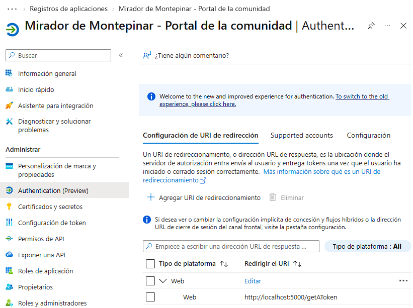
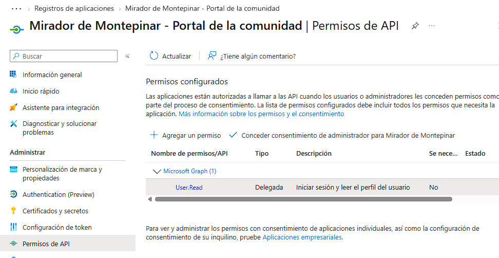
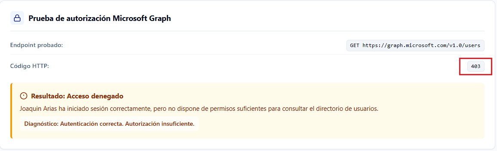
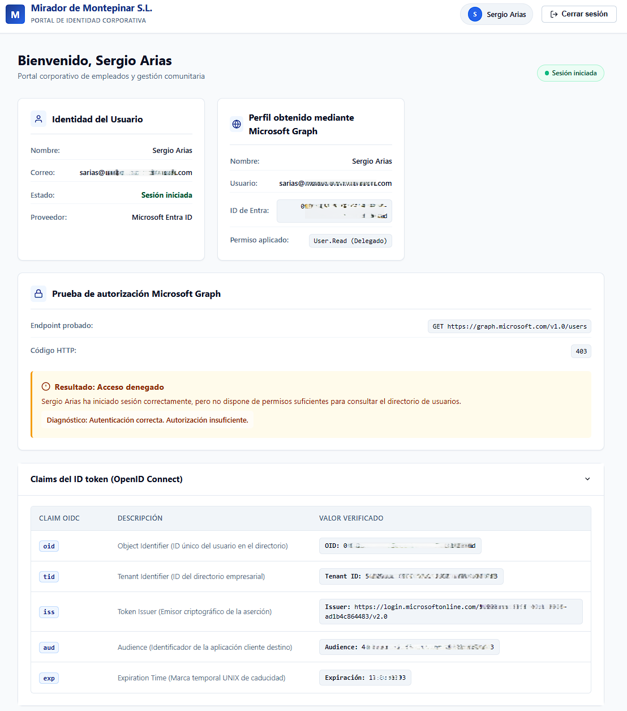
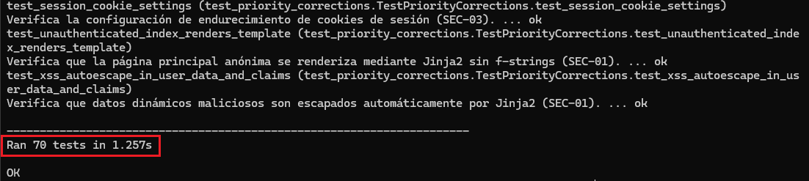

# Lab 09 — OAuth 2.0 y OpenID Connect con Microsoft Entra ID

Aplicación web de autenticación federada desarrollada con Python y Flask, integrada con Microsoft Entra ID y Microsoft Graph.

## 1. Descripción del proyecto

Este laboratorio toma como referencia el capítulo 3 de la primera temporada de *La que se avecina*, «Azulejos, un polígrafo y un paquete por correo».

En este episodio, Joaquín espera en el aeropuerto a una chica con la que ha iniciado una relación por Internet. Sin embargo, después de que Sergio y Eric le hagan creer que probablemente será poco atractiva, Joaquín decide marcharse y deja a su hermano Sergio esperándola. Cuando la chica aparece y resulta ser muy atractiva, Sergio no tarda en hacerse pasar por Joaquín para intentar conquistarla.

La situación plantea un problema habitual en seguridad informática: la suplantación de identidad. Sergio consigue presentarse ante otra persona utilizando una identidad que no le pertenece, aprovechándose de que nadie comprueba realmente quién está al otro lado.

Trasladamos esta situación a **Mirador de Montepinar S.L.**, donde la comunidad necesita disponer de un portal interno al que sus usuarios puedan acceder de forma segura. Para evitar que cualquiera pueda hacerse pasar por otro vecino, la aplicación delegará la autenticación en Microsoft Entra ID mediante OpenID Connect, utilizando el flujo de autorización de OAuth 2.0.

A lo largo del laboratorio construiremos una aplicación web con Python y Flask que permitirá iniciar sesión con una cuenta de Microsoft, consultar la identidad del usuario autenticado y acceder a determinados recursos de Microsoft Graph según los permisos concedidos.

Antonio Recio representa el punto de partida de las pruebas del laboratorio. Posteriormente, utilizaremos las cuentas de Joaquín Arias y Sergio Arias para comprobar que la aplicación identifica correctamente a distintos usuarios y adapta el contenido del portal a la identidad autenticada.

También trabajaremos distintos controles de seguridad de la aplicación, prestando atención a la protección de sesiones, CSRF, XSS, la gestión del estado del flujo de autenticación y el cierre de sesión.

Porque, a diferencia de Sergio, nuestra aplicación no puede fiarse de las apariencias: tiene que verificar correctamente la identidad antes de conceder acceso.

## 2. Objetivos del proyecto

El objetivo principal de este laboratorio es desarrollar una aplicación web que permita autenticar usuarios mediante Microsoft Entra ID, utilizando OAuth 2.0 y OpenID Connect, y aplicar controles de seguridad durante todo el proceso.

Para ello, se establecen los siguientes objetivos:

- **Implementar autenticación federada:** integrar Microsoft Entra ID en una aplicación Flask mediante OpenID Connect y la biblioteca MSAL.
- **Comprender el flujo OAuth 2.0 Authorization Code:** trabajar con el intercambio de códigos de autorización y la obtención de tokens.
- **Validar la identidad del usuario:** interpretar los claims del ID token y consultar el perfil del usuario autenticado mediante Microsoft Graph.
- **Aplicar el principio de mínimo privilegio:** configurar permisos delegados y comprobar cómo Microsoft Graph limita el acceso a recursos para los que la aplicación no dispone de autorización.
- **Proteger el flujo de autenticación:** implementar mecanismos de validación de estado, vinculación al navegador, control de caducidad y prevención de reutilización de flujos.
- **Endurecer la seguridad de la aplicación:** incorporar protección frente a XSS y CSRF, configurar adecuadamente las sesiones y validar los parámetros de configuración.
- **Implementar logging estructurado:** registrar los eventos relevantes de autenticación y mantener trazabilidad mediante identificadores de petición, evitando exponer información sensible.
- **Gestionar el cierre de sesión:** implementar la limpieza de la sesión local y la redirección al endpoint de cierre de sesión de Microsoft Entra ID.
- **Validar la implementación:** desarrollar pruebas automatizadas para comprobar los controles de seguridad y verificar manualmente el funcionamiento de la integración.

El resultado es un portal web funcional que permite comprender cómo se integra un proveedor de identidad externo en una aplicación y qué medidas deben aplicarse para proteger el proceso de autenticación.

## 3. Arquitectura

El laboratorio utiliza una arquitectura cliente-servidor basada en Python y Flask. La aplicación delega la autenticación en Microsoft Entra ID mediante OpenID Connect y OAuth 2.0 Authorization Code Flow con PKCE. Posteriormente, utiliza Microsoft Graph para consultar los recursos permitidos por los permisos delegados concedidos.

### 3.1. Esquema general

El flujo de funcionamiento sigue esta secuencia:

1. El usuario accede al portal desde el navegador y solicita iniciar sesión.
2. Flask utiliza MSAL para preparar el flujo de autenticación y redirigir al usuario a Microsoft Entra ID.
3. Microsoft Entra ID autentica al usuario y devuelve la respuesta de autorización a la ruta `/getAToken`.
4. La aplicación recupera el flujo original, comprueba que corresponde al intento de autenticación iniciado y procesa la respuesta mediante MSAL.
5. Se obtiene la información de identidad del usuario y se establece la sesión de Flask.
6. La aplicación consulta el perfil del usuario mediante Microsoft Graph y realiza una prueba adicional de acceso al directorio.
7. Cuando el usuario cierra la sesión, la aplicación elimina la sesión local y redirige al endpoint de cierre de sesión de Microsoft Entra ID.

En este proceso intervienen tres elementos con responsabilidades diferenciadas:

- **OpenID Connect:** proporciona información sobre la identidad del usuario autenticado.
- **OAuth 2.0:** permite obtener un token de acceso para utilizar recursos protegidos.
- **Microsoft Graph:** proporciona acceso a los recursos para los que la aplicación dispone de permisos.

El ID token contiene los claims utilizados para identificar al usuario. El access token se utiliza para autorizar las llamadas a Microsoft Graph. Ambos tokens cumplen funciones diferentes dentro del proceso.

### 3.2. Estructura del proyecto y componentes principales

```text
Lab-09-OAuth2-OIDC-Entra-ID/
├── .env.example
├── .gitignore
├── README.md
├── requirements.txt
├── run.py
├── app/
│   ├── __init__.py
│   ├── auth.py
│   ├── config.py
│   ├── flow_store.py
│   ├── graph.py
│   ├── logging_config.py
│   ├── routes.py
│   ├── static/
│   │   └── css/
│   │       └── style.css
│   └── templates/
│       ├── error.html
│       └── index.html
├── screenshots/
│   ├── 01_auth.png
│   ├── 02_msgraph.png
│   ├── 03_joaquin.png
│   ├── 04_sergio.png
│   ├── 05_forbidden.png
│   └── 06_test.png
└── tests/
    ├── test_flow_store.py
    ├── test_logging.py
    ├── test_logout.py
    └── test_priority_corrections.py
```

| Componente | Responsabilidad |
|---|---|
| `run.py` | Punto de entrada para ejecutar la aplicación Flask. |
| `app/__init__.py` | Inicialización de Flask, registro de rutas, configuración de seguridad y contexto de las peticiones. |
| `app/routes.py` | Gestión de las rutas principales: página de inicio, inicio de sesión, callback de autenticación y cierre de sesión. |
| `app/auth.py` | Integración con MSAL y gestión del flujo de autenticación. |
| `app/config.py` | Carga y validación estricta de la configuración de la aplicación y de Microsoft Entra ID. |
| `app/flow_store.py` | Almacenamiento temporal de los flujos de autenticación, con caducidad y vinculación al navegador. |
| `app/graph.py` | Comunicación con Microsoft Graph y tratamiento de las respuestas de la API. |
| `app/logging_config.py` | Configuración del sistema de logging estructurado en formato JSON. |
| `app/static/css/style.css` | Hoja de estilos corporativa con diseño responsive, paleta de colores de Mirador de Montepinar, tarjetas y tablas de diagnóstico. |
| `app/templates/` | Plantillas Jinja2 utilizadas para representar la interfaz y las páginas de error. |
| `tests/` | Pruebas automatizadas de autenticación, sesiones, logging y controles de seguridad. |

### 3.3. Configuración de Microsoft Entra ID

La aplicación utiliza un registro propio en Microsoft Entra ID, configurado para un único inquilino (*Single-tenant*).

Se ha configurado:

- Un identificador de aplicación (`CLIENT_ID`) y un identificador de inquilino (`TENANT_ID`).
- Un secreto de cliente (`CLIENT_SECRET`) almacenado exclusivamente mediante variables de entorno en el archivo local `.env`.
- Una URI de redirección (`REDIRECT_URI`): `http://localhost:5000/getAToken` para recibir la respuesta de autorización OAuth 2.0 y el código temporal.
- Una URI de retorno tras el cierre de sesión (`POST_LOGOUT_REDIRECT_URI`): `http://localhost:5000/` para devolver al usuario a la página principal tras el logout federado.
- El permiso delegado `User.Read` para consultar el perfil del usuario autenticado mediante Microsoft Graph.

La aplicación utiliza Authorization Code Flow con PKCE, junto con los parámetros `state` y `nonce` para reforzar la protección del proceso de autenticación.




### 3.4. Gestión de permisos y acceso a Microsoft Graph

La aplicación utiliza permisos delegados, actuando en nombre del usuario autenticado.

La consulta `GET https://graph.microsoft.com/v1.0/me` permite recuperar el perfil del usuario mediante el permiso delegado `User.Read`.

También se realiza una prueba de acceso al directorio mediante `GET https://graph.microsoft.com/v1.0/users`. Esta operación devuelve un error HTTP 403 porque la aplicación no dispone de los permisos necesarios para consultar el listado de usuarios.

Este comportamiento es intencionado y permite comprobar en la práctica el principio de mínimo privilegio: la aplicación solo debe disponer de los permisos que necesita para realizar sus funciones.

La consulta al directorio se realiza desde el servidor durante el procesamiento del callback de autenticación. No existe una ruta Flask independiente `/users` en el portal.




### 3.5. Controles de seguridad de la arquitectura

La aplicación incorpora controles en diferentes capas:

| Capa | Controles implementados |
|---|---|
| Autenticación | OAuth 2.0, OpenID Connect, PKCE, `state` y `nonce`. |
| Gestión de flujos | Almacenamiento temporal en servidor, vinculación al navegador, caducidad y prevención de reutilización. |
| Protección web | Plantillas Jinja2 con autoescape y protección CSRF mediante Flask-WTF. |
| Sesiones | Cookies configuradas, caducidad y limpieza de la sesión anterior al establecer una nueva identidad. |
| Configuración | Validación de parámetros y almacenamiento de secretos mediante variables de entorno. |
| Auditoría | Logging estructurado, identificadores de petición y exclusión de información sensible. |

El almacenamiento de flujos se realiza actualmente en memoria mediante `FlowStore`, por lo que está orientado a este entorno de laboratorio. Una implementación de producción con múltiples procesos o instancias necesitaría un almacenamiento compartido con caducidad, como Redis.

## 4. Fases de implementación

El desarrollo del laboratorio se realizó en varias fases. Cada una incorporó funcionalidad y controles de seguridad, seguidos de pruebas y revisiones para comprobar que los cambios no afectaban a los flujos que ya funcionaban.

### Fase 1. Registro y configuración de la aplicación en Microsoft Entra ID

El primer paso fue registrar la aplicación web de Mirador de Montepinar S.L. en el inquilino de Microsoft Entra ID.

**Nombre del registro:** `Mirador de Montepinar - Portal de la comunidad`

Se configuró una aplicación de tipo Web, con autenticación de un único inquilino y las siguientes direcciones:

| Configuración | URI | Descripción |
|---|---|---|
| URI de redirección (`REDIRECT_URI`) | `http://localhost:5000/getAToken` | Endpoint de callback donde Entra ID devuelve el código de autorización. |
| URI de retorno tras logout (`POST_LOGOUT_REDIRECT_URI`) | `http://localhost:5000/` | Endpoint al que Entra ID redirige tras completar el cierre de sesión federado. |

También se creó un secreto de cliente para que Flask pudiera autenticarse como aplicación confidencial. El secreto se guarda en `.env` y no forma parte del repositorio.

El registro utiliza el permiso delegado `User.Read` de Microsoft Graph. Se decidió no conceder permisos adicionales de lectura del directorio, ya que el laboratorio debía demostrar el principio de mínimo privilegio.

### Fase 2. Implementación del flujo OAuth 2.0 y OpenID Connect

Se desarrolló la integración entre Flask y Microsoft Entra ID mediante la biblioteca MSAL para Python.

La aplicación utiliza **Authorization Code Flow con PKCE**, un flujo adecuado para aplicaciones web confidenciales que permite reforzar la seguridad del intercambio del código de autorización.

El proceso se desarrolló de la siguiente manera:

1. El usuario solicita iniciar sesión desde el portal.
2. MSAL prepara la solicitud de autorización y genera los parámetros necesarios para el flujo.
3. Se incorporan `state`, `nonce` y el material de PKCE, utilizando el método S256.
4. El navegador es redirigido al endpoint de autorización de Microsoft Entra ID.
5. Tras autenticarse, el usuario vuelve al callback `/getAToken` con el código de autorización y el estado.
6. Flask recupera el flujo original y comprueba que corresponde al intento de autenticación iniciado.
7. MSAL realiza el intercambio del código de autorización por los tokens correspondientes.
8. Se procesan los claims de identidad del ID token y se establece la sesión del usuario.

Los mecanismos utilizados cumplen funciones diferentes:

- **`state`:** permite vincular la respuesta recibida con la solicitud de autenticación original y ayuda a proteger el flujo frente a respuestas no solicitadas.
- **`nonce`:** vincula el ID token recibido con la solicitud de autenticación que lo originó, contribuyendo a prevenir ataques de repetición del token.
- **PKCE:** utiliza un `code_verifier` y un `code_challenge` para comprobar que quien canjea el código de autorización dispone del verificador original.

Se separó la lógica de autenticación de las rutas Flask, manteniendo la integración con MSAL en los módulos correspondientes.

### Fase 3. Desarrollo del almacenamiento temporal FlowStore

Uno de los trabajos más importantes del laboratorio fue diseñar un mecanismo para gestionar los datos temporales de los intentos de autenticación sin introducirlos directamente en la cookie del navegador.

Para ello se desarrolló `FlowStore`, un almacenamiento temporal en memoria del servidor.

Cada flujo conserva la información necesaria para completar su callback correspondiente, incluyendo el estado, el verificador PKCE, el nonce y los datos necesarios para vincular el flujo al navegador.

Se implementaron los siguientes controles:

- **Caducidad:** tiempo de vida de 600 segundos por flujo.
- **Vinculación al navegador:** cada flujo incorpora un `binding_token` generado mediante `secrets.token_urlsafe(32)`.
- **Comparación segura:** se utiliza `secrets.compare_digest()` para validar el token de vinculación.
- **Consumo atómico:** `pop_flow()` recupera y consume el flujo en una única operación protegida por `threading.Lock`.
- **Protección frente a reutilización:** un flujo consumido no puede volver a utilizarse.
- **Gestión de caducidad:** los flujos caducados se rechazan y se eliminan del almacenamiento.
- **Concurrencia:** se permiten varios intentos independientes de autenticación desde distintas pestañas del mismo navegador.
- **Límite de almacenamiento:** se permiten hasta diez flujos por navegador. Cuando se alcanza el límite, se expulsa el más antiguo antes de añadir uno nuevo.

También se probaron situaciones de fallo, como callbacks iniciados desde otro navegador, estados incorrectos, intentos repetidos y flujos expirados.

Este componente evita depender únicamente de los parámetros que devuelve el navegador y mantiene los datos sensibles del proceso de autenticación bajo control del servidor.

El bloqueo de concurrencia protege las operaciones dentro del mismo proceso de la aplicación. No sustituye a un almacenamiento compartido cuando se utilizan varios procesos o instancias.

### Fase 4. Endurecimiento de seguridad de la aplicación Flask

Una vez completada la autenticación, se realizó una revisión de seguridad del portal. Esta fase dio lugar a seis bloques de corrección y mejora, identificados como SEC-01 a SEC-06.

#### SEC-01. Protección frente a Cross-Site Scripting (XSS)

Se revisó el renderizado de contenido dinámico y se sustituyó la construcción de HTML mediante cadenas `f-string` por plantillas Jinja2.

La aplicación utiliza el autoescape de Jinja2 para escapar los valores procedentes del usuario y de los claims antes de mostrarlos en el navegador.

Se agregaron pruebas para comprobar que los datos manipulados se representan como contenido y no se interpretan como código HTML o JavaScript.

#### SEC-02. Protección CSRF

Se integró Flask-WTF para proteger los formularios mediante tokens CSRF.

Se prestó especial atención al cierre de sesión: el endpoint `/logout` requiere una petición POST protegida.

Una petición GET a esta ruta no ejecuta el cierre de sesión. También se probaron tanto las peticiones sin un token válido como las que incluyen un token correcto.

#### SEC-03. Protección y gestión de sesiones

Se reforzó la configuración de las sesiones de Flask:

- Cookies `HttpOnly`.
- Política `SameSite=Lax`.
- Parámetro `Secure` configurable para entornos HTTPS.
- Firma criptográfica de las cookies.
- Expiración de sesión.
- Limpieza de la sesión anterior mediante `session.clear()` antes de establecer una nueva identidad.

Se comprobó que los datos temporales del flujo OAuth, como el `code_verifier` y el `nonce`, no se almacenan en la cookie del navegador.

Las sesiones predeterminadas de Flask están firmadas, pero no cifradas. Por este motivo, la aplicación evita almacenar en ellas secretos, tokens de acceso o información sensible del proceso de autenticación.

#### SEC-04. Validación de configuración y gestión de secretos

Se centralizaron las variables de configuración y se incorporaron validaciones para reducir errores de configuración.

Se revisaron, entre otros, los siguientes elementos:

- Clave de sesión de Flask (`FLASK_SECRET_KEY`): longitud mínima de 32 caracteres, comprobación de entropía y rechazo de marcadores de posición o plantillas.
- Parámetro `SESSION_COOKIE_SECURE`: validación estricta de valores booleanos (`true` o `false`).
- Identificador del tenant (`TENANT_ID`): comprobación de UUID o FQDN válido y rechazo de endpoints genéricos.
- URI de retorno tras el cierre de sesión (`POST_LOGOUT_REDIRECT_URI`): validación estricta de esquemas y destinos seguros.
- Tiempo de vida de la sesión (`PERMANENT_SESSION_LIFETIME_MINUTES`): entero positivo mayor o igual a 1.
- Separación entre configuraciones de ejemplo y secretos reales.

El archivo `.env` permanece fuera del repositorio (protegido mediante `.gitignore`) y `.env.example` sirve como referencia para preparar una instalación.

#### SEC-05. Logging estructurado y protección de información sensible

Se implementó un sistema de logging estructurado en formato JSON.

El formato controla los campos permitidos mediante una lista explícita y utiliza un identificador de petición generado en el servidor.

Se evitó registrar tokens de acceso, secretos de cliente y otros elementos sensibles del proceso de autenticación.

También se revisaron los datos adicionales que pueden llegar a los registros para impedir que información arbitraria termine exponiéndose.

#### SEC-06. Cierre de sesión OIDC

Se implementó el cierre de sesión federado teniendo en cuenta los dos niveles de la aplicación:

- Limpieza de la sesión local de Flask.
- Redirección al endpoint de cierre de sesión del inquilino de Microsoft Entra ID.

Se configuró `post_logout_redirect_uri` para que el usuario vuelva al portal después de completar el cierre de sesión.

Se comprobó que el URI de retorno está registrado en la configuración de la aplicación y se revisó que no se confundiera con la configuración independiente de cierre de sesión del canal frontal.

También se decidió no conservar el ID token para enviarlo como parámetro `id_token_hint` durante el cierre de sesión. La aplicación mantiene una gestión de sesión más sencilla y evita introducir almacenamiento adicional que no resulta necesario para el alcance del laboratorio.

### Fase 5. Integración con Microsoft Graph y autorización

Una vez conseguida la autenticación, se incorporó Microsoft Graph para consultar información corporativa utilizando el token de acceso delegado.

Se implementaron dos escenarios para demostrar la diferencia entre autenticación y autorización.

**Consulta del perfil personal: `GET https://graph.microsoft.com/v1.0/me`**

La aplicación utiliza el permiso delegado `User.Read` para consultar el perfil del usuario que ha iniciado sesión.

Los datos obtenidos se utilizan para mostrar información dinámica en el portal, como el nombre y el identificador de la cuenta.

**Consulta de otros usuarios: `GET https://graph.microsoft.com/v1.0/users`**

Se realizó una segunda consulta para comprobar qué ocurría al intentar acceder al directorio de usuarios con los permisos concedidos.

Microsoft Graph devuelve HTTP 403 Forbidden porque la aplicación no dispone de los permisos necesarios para realizar esa operación.

El resultado es deliberado. El usuario está autenticado, pero la aplicación no tiene autorización suficiente para consultar el directorio completo.

De esta forma se demuestra que disponer de una identidad válida no implica tener acceso a todos los recursos corporativos.




### Fase 6. Identidad dinámica y validación con usuarios reales

Durante las primeras fases del laboratorio se utilizaron distintas cuentas de prueba para comprobar la integración con Entra ID.

Posteriormente se revisó la aplicación para eliminar cualquier dependencia de una identidad codificada manualmente y hacer que el portal represente dinámicamente al usuario autenticado.

La plantilla utiliza los datos de identidad y del perfil de Graph para mostrar el contenido correspondiente a cada sesión.

Se realizaron autenticaciones reales contra el inquilino con dos usuarios:

- **Joaquín Arias (`jarias`).**
- **Sergio Arias (`sarias`).**

En ambos casos se comprobó que el inicio de sesión se completaba correctamente y que el portal mostraba la identidad correspondiente a la cuenta autenticada.

Se verificó también el cierre de sesión real contra Microsoft Entra ID.




### Fase 7. Gestión de errores y validación de casos límite

Se revisó el comportamiento de la aplicación cuando el callback OAuth/OIDC no devuelve los datos esperados.

Se corrigieron las respuestas HTTP para representar mejor el origen de cada fallo:

| Situación | Código HTTP | Tratamiento |
|---|---:|---|
| Error OAuth durante la devolución de llamada o el intercambio del código | 400 Bad Request | Se muestra el error de autenticación y se consume el flujo. |
| MSAL no devuelve `access_token` | 502 Bad Gateway | Se trata como una respuesta inesperada del proveedor de identidad. |
| No se reciben los claims de identidad | 502 Bad Gateway | Se rechaza la creación de la sesión autenticada. |
| Microsoft Graph deniega el acceso a `/users` | 403 Forbidden | Se informa de la falta de permisos sobre el recurso. |

Se agregaron pruebas específicas para los errores de ausencia de `access_token` y de claims OIDC.

También se actualizó la prueba que comprueba el tratamiento de errores OAuth para verificar el nuevo código HTTP 400.

En los escenarios de error se comprueba que el flujo temporal queda eliminado cuando corresponde y que no se establece una sesión autenticada.

### Fase 8. Pruebas automatizadas, auditoría y correcciones finales

El laboratorio se sometió a varios ciclos de revisión y corrección. Se inspeccionaron las rutas, las plantillas, la gestión de sesiones, los flujos temporales, la integración con Graph, la configuración estricta y las pruebas automatizadas.

La suite se ejecuta mediante:

```powershell
python -m unittest discover tests -v
```

La validación final obtuvo el siguiente resultado:

```text
Ran 70 tests
OK
```

Se incorporan pruebas para verificar el comportamiento ante errores de autenticación, la limpieza del `FlowStore`, la configuración de sesiones, la protección CSRF, el autoescape de Jinja2, la validación exhaustiva de claves y cookies de sesión, y la representación dinámica de distintas identidades.

Las pruebas automatizadas utilizan simulaciones cuando es necesario aislar las dependencias externas. Las autenticaciones con Joaquín y Sergio se validaron manualmente contra el inquilino real de Microsoft Entra ID.

La revisión final también incluyó la fijación de las cinco dependencias directas en `requirements.txt`, utilizando las versiones verificadas en el entorno virtual del proyecto.

El resultado es una aplicación que ha pasado tanto por pruebas automatizadas como por comprobaciones manuales contra un inquilino real de Microsoft Entra ID.




## 5. Conclusiones y resultados de validación

El laboratorio ha permitido desarrollar y comprobar una aplicación web que delega la autenticación en Microsoft Entra ID mediante OAuth 2.0 y OpenID Connect.

El resultado no se limita a completar un inicio de sesión. Se ha trabajado en el ciclo completo de autenticación, desde la creación de la solicitud y el almacenamiento temporal del flujo hasta el procesamiento del callback, la creación de la sesión, las consultas a Microsoft Graph y el cierre de sesión federada.

### Resultados técnicos

| Área | Resultado |
|---|---|
| OAuth 2.0 | Authorization Code Flow implementado. |
| OpenID Connect | Claims de identidad integrados en la aplicación. |
| PKCE | Implementado con S256. |
| Estado y nonce | Gestión integrada en el flujo de autenticación. |
| FlowStore | Almacenamiento temporal con caducidad, vinculación al navegador y protección frente a reutilización. |
| Sesiones Flask | Cookies configuradas y limpieza de los datos de sesión anteriores antes de establecer una nueva identidad. |
| CSRF | Protección de formularios y cierre de sesión mediante POST. |
| XSS | Autoescape mediante Jinja2. |
| Logging | Registros JSON con campos controlados e identificadores de petición. |
| Microsoft Graph | Consulta del perfil personal mediante `User.Read`. |
| Mínimo privilegio | Acceso a `/users` rechazado por Microsoft Graph con HTTP 403. |
| Cierre de sesión | Cierre de sesión local y redirección al endpoint de Microsoft Entra ID. |
| Pruebas | 70 tests superados, sin fallos. |

### Validación con Microsoft Entra ID

Se realizaron pruebas manuales con dos identidades reales del inquilino:

- Joaquín Arias inició sesión correctamente y el portal mostró sus datos.
- Sergio Arias inició sesión correctamente y el portal mostró su propia identidad.

Se comprobó que ambas cuentas utilizan la misma aplicación y que la información mostrada depende de la identidad autenticada.

También se validó el cierre de sesión real contra Microsoft Entra ID.

### Resultado de la suite automatizada

```text
Ran 70 tests
OK
```

Las pruebas incluyen escenarios de funcionamiento normal, errores OAuth/OIDC, validaciones estrictas de configuración y controles de seguridad. Las autenticaciones reales con Joaquín y Sergio se registraron como validaciones manuales independientes de la suite automatizada.

El laboratorio queda validado para su propósito formativo en un entorno local. No se presenta como una aplicación lista para producción.

## 6. Puesta en marcha local

El proyecto utiliza Python 3.13 y requiere una configuración propia de Microsoft Entra ID.

Desde el directorio raíz del proyecto, los pasos para ejecutarlo en Windows son:

**1. Crear el entorno virtual**

```powershell
python -m venv .venv
```

**2. Activar el entorno virtual**

```powershell
.\.venv\Scripts\Activate.ps1
```

**3. Instalar las dependencias**

```powershell
python -m pip install -r requirements.txt
```

**4. Preparar la configuración**

Crear el archivo `.env` a partir de `.env.example`:

```powershell
Copy-Item .env.example .env
```

Generar una clave secreta criptográficamente segura para Flask (mínimo 32 caracteres y alta entropía):

```powershell
python -c "import secrets; print(secrets.token_urlsafe(48))"
```

Configurar en el archivo `.env`:
- `CLIENT_ID`: Identificador de la aplicación registrada en Microsoft Entra ID.
- `TENANT_ID`: Identificador del directorio inquilino (UUID o nombre de dominio).
- `CLIENT_SECRET`: Valor secreto del cliente generado en Entra ID.
- `REDIRECT_URI`: `http://localhost:5000/getAToken` (debe coincidir con la URI de redirección registrada en Entra ID).
- `POST_LOGOUT_REDIRECT_URI`: `http://localhost:5000/` (URI de retorno posterior al cierre de sesión).
- `FLASK_SECRET_KEY`: La clave generada con el comando superior. La aplicación valida que tenga al menos 32 caracteres, suficiente entropía y rechazará claves de ejemplo o predeterminadas, impidiendo el arranque si la clave es insegura.
- `SESSION_COOKIE_SECURE`: `false` para pruebas locales en HTTP (`true` para despliegues con HTTPS).
- `PERMANENT_SESSION_LIFETIME_MINUTES`: Duración en minutos de la sesión permanente (por defecto `60`).

> [!IMPORTANT]
> El archivo `.env` contiene credenciales confidenciales y secretos criptográficos. Está incluido en `.gitignore` y **nunca debe subirse al repositorio ni compartirse**.

**5. Ejecutar la aplicación**

```powershell
python run.py
```

Abrir el portal en el navegador:

```text
http://localhost:5000
```

Las URI utilizadas durante la configuración de Microsoft Entra ID deben coincidir exactamente con las registradas en el proyecto:
- **URI de redirección:** `http://localhost:5000/getAToken`
- **URI de cierre de sesión:** `http://localhost:5000/`

**6. Ejecutar las pruebas automatizadas**

Desde la raíz del proyecto y con el entorno virtual activo:

```powershell
python -m unittest discover tests -v
```

## 7. Limitaciones, decisiones de arquitectura y próximas mejoras

El laboratorio está diseñado para aprender y validar conceptos de IAM en un entorno controlado. Durante su desarrollo se identificaron varias limitaciones que deben abordarse antes de utilizar la aplicación en un entorno productivo.

### Limitaciones actuales

#### Almacenamiento temporal en memoria

`FlowStore` utiliza memoria local del proceso Flask. El diseño incorpora bloqueo de concurrencia, caducidad y control de reutilización, pero no permite compartir automáticamente los flujos entre distintos procesos o instancias de la aplicación.

En un despliegue distribuido sería necesario migrarlo a un almacenamiento compartido, como Redis, con caducidad de claves.

#### Sesiones firmadas, pero no cifradas

Las cookies de sesión de Flask están protegidas mediante firma criptográfica, pero su contenido no está cifrado. La aplicación evita guardar en ellas tokens de acceso o datos sensibles del proceso PKCE.

Para un despliegue real habría que revisar también la gestión de claves, el almacenamiento de sesiones y los requisitos operativos del entorno.

#### Sin caché persistente de tokens

El token de acceso obtenido se utiliza para consultar Microsoft Graph, pero no se conserva como parte de la sesión web ni se ha implementado una caché persistente para renovar tokens silenciosamente.

Si se incorporase acceso prolongado a recursos protegidos, habría que diseñar una estrategia específica de caché y protección de tokens.

#### Cierre de sesión sin `id_token_hint`

Se decidió no conservar el ID token únicamente para enviarlo durante el cierre de sesión. La aplicación limpia la sesión local y redirige al endpoint de cierre de sesión del inquilino.

Esta decisión evita añadir almacenamiento y complejidad que no son necesarios para demostrar el flujo implementado.

#### Entorno local de desarrollo

Las direcciones `localhost` y la configuración actual están destinadas a pruebas locales. Un despliegue productivo necesitaría HTTPS, una gestión adecuada de secretos, configuración específica del entorno y una revisión completa de seguridad.

### Próximas mejoras

- Migrar `FlowStore` a Redis para soportar múltiples procesos e instancias.
- Implementar una estrategia de caché segura de tokens y renovación silenciosa cuando el caso de uso lo requiera.
- Añadir pruebas de integración controladas contra Microsoft Graph, además de las pruebas con dependencias simuladas.
- Preparar un entorno de despliegue con HTTPS y un sistema externo de gestión de secretos.
- Incorporar monitorización de eventos de autenticación y autorización.
- Estudiar la integración del cierre de sesión de canal frontal para escenarios de inicio de sesión único con varias aplicaciones.

---
